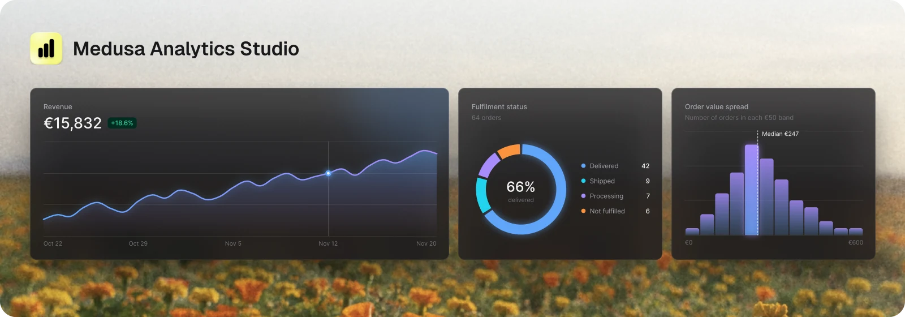
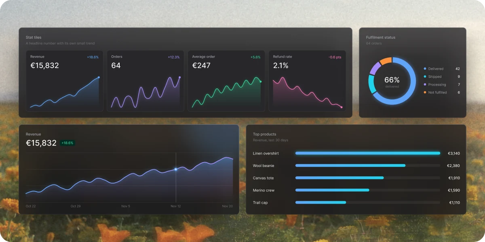
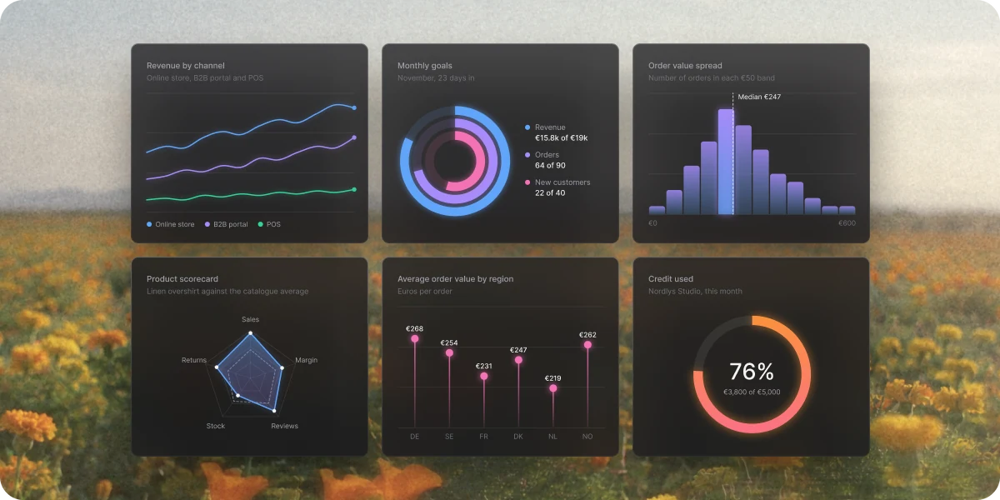
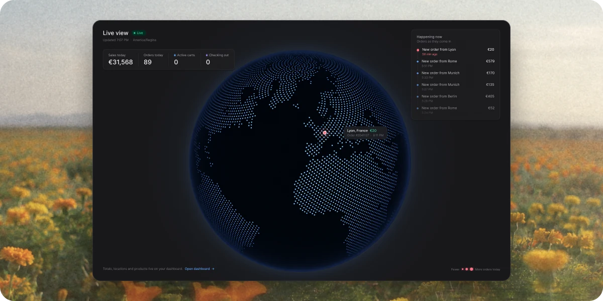
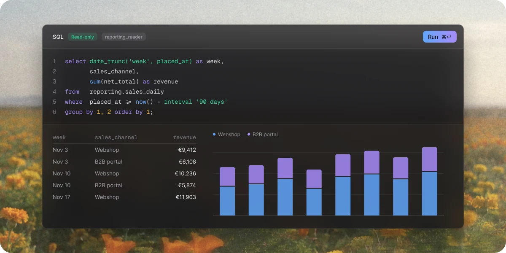

<p align="center">
  <a href="https://www.306technologies.com"><picture><source media="(prefers-color-scheme: dark)" srcset="https://raw.githubusercontent.com/306-Technologies/medusa-analytics-studio/main/.github/assets/lockup-dark.svg"></picture></a>
</p>

<p align="center">
  
</p>

# Medusa Analytics Studio

`@306technologies/medusa-analytics-studio` · Analytics for the Medusa Admin: sales reports, a customisable dashboard, a live view of today's orders and an optional read-only SQL editor. Reports read from pre-computed sales facts, not raw orders, on their own read-only connection pool, so they never slow down checkout.

<p align="center">
  <a href="https://www.npmjs.com/package/@306technologies/medusa-analytics-studio"></a>
  <a href="https://docs.medusajs.com"></a>
  <a href="https://github.com/306-Technologies/medusa-analytics-studio/blob/main/LICENSE"></a>
</p>

---

<h3 align="center">Built by <a href="https://www.306technologies.com">306 Technologies</a></h3>
<p align="center">
  Medusa & headless commerce experts. Senior-led engineering, accelerated by AI.
</p>
<p align="center">
  <a href="https://www.306technologies.com"></a>
  <a href="https://cal.com/team/306-technologies/meeting-with-raj?overlayCalendar=true"></a>
  <a href="mailto:info@306technologies.com"></a>
</p>

---

## Features

- **Dashboard**: drag-and-drop tiles, each a saved report with its own chart.
- **Reports**: built-in reports and your own, written in a small query language with a visual editor and 19 chart types.
- **Live view**: today's orders, active carts and checkouts on a globe, refreshed every 10 seconds.
- **SQL mode** (optional, off by default): admin-written SQL over curated reporting views, as a restricted read-only Postgres role.
- **Sales facts**: per-order and per-line facts plus daily rollups, kept current from order and refund events, with currency conversion and a store-wide reporting timezone.
- **Read-only by design**: see [Safety](#safety).

<table>
  <tr>
    <td width="50%" valign="top">
      <br>
      <b>Dashboard</b>
    </td>
    <td width="50%" valign="top">
      <br>
      <b>Reports</b>
    </td>
  </tr>
  <tr>
    <td width="50%" valign="top">
      <br>
      <b>Live view</b>
    </td>
    <td width="50%" valign="top">
      <br>
      <b>SQL mode</b>
    </td>
  </tr>
</table>

## Requirements

- Medusa `2.19.0`. All `@medusajs/*` packages must be on the same version as the plugin's peer dependencies.
- PostgreSQL (tested with 16).
- Redis recommended in production (`REDIS_URL`): report caching, queued events and one-instance-at-a-time jobs.

## Install

```bash
yarn add @306technologies/medusa-analytics-studio
```

Register the plugin, then list its modules under `modules` so each one gets its own options. A plugin's `options` would otherwise go to every module alike.

```ts
// medusa-config.ts
import { defineConfig } from "@medusajs/framework/utils"

const plugin = "@306technologies/medusa-analytics-studio"

module.exports = defineConfig({
  // projectConfig: { ... },
  plugins: [{ resolve: plugin, options: {} }],
  modules: [
    {
      resolve: `${plugin}/modules/analytics-workspace`,
      options: { readOnly: false },
    },
    {
      resolve: `${plugin}/modules/sales-facts`,
      options: { jobsEnabled: true },
    },
    {
      resolve: `${plugin}/modules/analytics-reader`,
      options: {
        databaseUrl: process.env.ANALYTICS_DATABASE_URL,
        separateDatabase: Boolean(process.env.ANALYTICS_DATABASE_URL),
      },
    },
    {
      resolve: `${plugin}/modules/analytics-sql`,
      options: { disabled: true, ssl: false },
    },
  ],
})
```

Then run the migrations and start Medusa:

```bash
npx medusa db:migrate
npx medusa develop
```

On a large store (hundreds of thousands of orders or more), build the analytics indexes on `order` and `cart` without blocking checkout before the first `db:migrate`; the migration then finds them and does nothing:

```bash
psql "$DATABASE_URL" -f node_modules/@306technologies/medusa-analytics-studio/sql/create-indexes-concurrently.sql
```

The first backfill of sales facts runs within five minutes of boot. Until it finishes, reports show that they are still filling.

## Options

### `analytics-reader`

| Option               | Default           |                                                                                |
| -------------------- | ----------------- | ------------------------------------------------------------------------------ |
| `databaseUrl`        | the main database | Where reports read from, for example a read replica.                           |
| `separateDatabase`   | `false`           | `true` when `databaseUrl` is not the main database. Requires `databaseUrl`.    |
| `poolMax`            | `3`               | Most connections the report pool may hold.                                     |
| `statementTimeoutMs` | `15000`           | Postgres cancels any report query running longer than this.                    |
| `ssl`                | `false`           | TLS for the report pool. Encrypts, but does not verify the server certificate. |

### `sales-facts`

| Option        | Default                  |                                                                                                                        |
| ------------- | ------------------------ | ---------------------------------------------------------------------------------------------------------------------- |
| `jobsEnabled` | `true`                   | Run the backfill, drain, reconcile and exchange-rate jobs. Set `false` on instances that should leave them to another. |
| `fxUrl`       | Frankfurter's public API | A Frankfurter-compatible `https` URL for exchange rates, or `"off"`.                                                   |
| `database`    | the shared connection    | Medusa module database options, to give the facts their own small pool.                                                |

### `analytics-workspace`

| Option     | Default |                                                                                                                      |
| ---------- | ------- | -------------------------------------------------------------------------------------------------------------------- |
| `readOnly` | `false` | The host refuses writes (for example a public demo): the admin keeps saved reports and the dashboard in the browser. |

### `analytics-sql`

SQL mode stays off unless `disabled` is explicitly `false`, a password is set, and the role and replica checks pass.

| Option                 | Default  |                                                                                              |
| ---------------------- | -------- | -------------------------------------------------------------------------------------------- |
| `disabled`             | required | `true` turns SQL mode off whatever else is set.                                              |
| `password`             | none     | Password for the `reporting_reader` role: at least 16 printable ASCII characters, no spaces. |
| `analyticsDatabaseUrl` | none     | The read replica SQL mode runs on.                                                           |
| `allowPrimary`         | `false`  | Run on the primary when there is no replica.                                                 |
| `mainDatabaseUrl`      | none     | The primary, where the role and its grants are set up.                                       |
| `reportingViews`       | none     | Views the role may read: names, `"prefix_*"` or `"*"`.                                       |
| `poolMax`              | `2`      | Connections per instance.                                                                    |
| `connectionLimit`      | `5`      | The role's connection limit.                                                                 |
| `ssl`                  | required | TLS for SQL-mode connections. Encrypts, but does not verify the server certificate.          |

When the app's database user can create roles, the role is set up at boot. Otherwise add this one-line script to your app, so the command the admin suggests has a stable path:

```ts
// src/scripts/setup-sql-role.ts
export { default } from "@306technologies/medusa-analytics-studio/scripts/setup-sql-role"
```

Then print the statements for a database admin:

```bash
yarn medusa exec ./src/scripts/setup-sql-role.ts print
```

The output holds the password's SCRAM verifier: treat it as a secret. Use a random password of 32 or more characters.

#### Add your own views

SQL mode reads only views in the `reporting` schema, so data from your own modules (loyalty points, subscriptions, B2B accounts) needs a view there. The plugin ships `sales_daily` and `analytics_reports_daily`. Build yours with the same helper, in a migration of one of your app's modules:

```ts
// src/modules/loyalty/migrations/Migration20260101000000.ts
import { Migration } from "@medusajs/framework/mikro-orm/migrations"
import {
  dropReportingView,
  reportingView,
} from "@306technologies/medusa-analytics-studio/shared/analytics/reporting-view"

export class Migration20260101000000 extends Migration {
  override async up(): Promise<void> {
    this.addSql(
      reportingView({
        name: "loyalty_points_daily",
        comment: "Loyalty points earned and spent per day",
        sql: `
          select created_at::date as day,
                 sum(points) filter (where points > 0) as earned,
                 -sum(points) filter (where points < 0) as spent
          from loyalty_transaction
          where deleted_at is null
          group by 1`,
        columns: {
          day: "Day, in UTC",
          earned: "Points earned",
          spent: "Points spent",
        },
      })
    )
  }

  override async down(): Promise<void> {
    this.addSql(dropReportingView("loyalty_points_daily"))
  }
}
```

- `reportingView` creates the `reporting` schema if needed, then `create or replace view reporting.<name>` with your `select`, and the view and column comments. The SQL editor shows those comments in its views panel.
- `name` and column names: lowercase letters, digits and `_`, starting with a letter, at most 63 characters.
- `sql` is one `select` (or `with ... select`). A trailing `;` is dropped.
- The view runs with its owner's rights, so it may join any table, and SQL mode sees only the columns you select. Leave out customer details (emails, names, addresses) unless admins should query them.
- `create or replace` can only add columns at the end. To rename, remove or reorder columns, call `dropReportingView(name)` first in the same migration.

Then:

1. Run `npx medusa db:migrate`.
2. Add the view to `reportingViews` (`"loyalty_points_daily"`, or a prefix such as `"loyalty_*"`). A view that isn't listed shows as "Not enabled yet" in the views panel, and SQL mode can't read it.
3. Restart the app. Grants are applied at boot, on the primary: the role is granted `select` on each listed view and loses access to every other view in the schema. Running the `setup-sql-role` script without `print` applies them too.

On a streaming read replica, the views and grants arrive by replication. They don't need to be created there.

## Query language

```text
FROM sales
SHOW total_sales, orders
GROUP BY month
SINCE -12m UNTIL today
COMPARE TO previous_year
ORDER BY total_sales DESC
LIMIT 10
CURRENCY eur
```

- **Metrics**: `orders`, `gross_sales`, `discounts`, `returns`, `refunds`, `net_sales`, `shipping`, `taxes`, `total_sales`, `average_order_value`, `units`, `returned_units`, `net_units`, `customers`, `new_customers`, `returning_customers`.
- **Dimensions** (up to two): `day`, `week`, `month`, `day_of_week`, `hour_of_day`, `country`, `city`, `sales_channel`, `customer_type`, `product`, `variant`.
- **Dates**: `today`, `yesterday`, `-30d`, `-4w`, `-3m`, `-1y` or `2026-01-31`.
- **Compare**: `previous_period` or `previous_year`.

Reports can also be run without HTTP:

```ts
const reader = container.resolve("analyticsReader")
const result = await reader.runReport(
  "FROM sales SHOW orders SINCE -6d UNTIL today",
  { currency: "eur", timezone: "UTC" }
)
```

## Safety

Reports cannot write to your database. Each layer holds on its own:

1. The query language accepts only its own clauses and listed metric and dimension names. The server builds the SQL; values are bound parameters.
2. Every report query runs in its own transaction that starts `SET TRANSACTION READ ONLY` with a local statement timeout, so nothing a query does to the session can make a later one writable.
3. The reader runs only a single `SELECT` or `WITH` statement with no write keywords, and refuses functions that could change the session, take locks or reach outside the database.
4. Every report connection is opened with `default_transaction_read_only = on`, and one whose setting cannot be confirmed is discarded.

SQL mode runs as a role that can read only the listed views, inside a read-only transaction with a statement timeout and a row cap. It turns itself off if the role can read anything else, or create objects on the primary.

The plugin does not refuse writes for a public demo by itself. Pair `readOnly` with your own write guard.

## Admin

- **Analytics** in the sidebar: dashboard, reports, live view.
- **SQL** at `/app/analytics/sql`, only when SQL mode is on.
- **Reporting timezone** widget on the store details page.

## Development

```bash
npm install
npm run build       # compile to .medusa/server
npm run dev         # rebuild on change, for a Medusa app linked to this plugin
npm run test:unit
npm run check-types
npm run lint
npm run format
```

Generate migrations for a changed model with `npx medusa plugin:db:generate`.

Every change needs an entry in [CHANGELOG.md](CHANGELOG.md), and releases follow [Semantic Versioning](https://semver.org/).

Issues and pull requests are welcome at [github.com/306-Technologies/medusa-analytics-studio](https://github.com/306-Technologies/medusa-analytics-studio). Accepted changes are applied upstream and released from there, so a merged pull request appears in the next release.

## Links

- **Website:** [306technologies.com](https://www.306technologies.com)
- **Book a call:** [30 min with 306 Technologies](https://cal.com/team/306-technologies/meeting-with-raj?overlayCalendar=true)
- **Email:** [info@306technologies.com](mailto:info@306technologies.com)

## License

[MIT](LICENSE) © 306 Technologies
